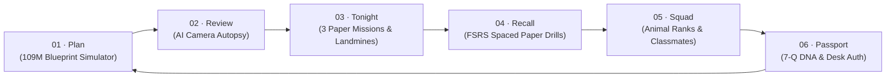

# 📐 BuddyBoardz

> **"The only exam prep app that tells you to put your phone face-down and pick up a blue ink pen."**  
> *Engineered for GSEB Class 10 (English Medium) · Surat, Gujarat · 100% Offline-First*

---

```
                       ┌────────────────────────┐
                       │   (• ‿ •)  BUDDY      │
                       │  "Close this screen.   │
                       │   Write Q4 on paper."  │
                       └──────────┬─────────────┘
                                  │
      ┌───────────────────────────┴───────────────────────────┐
      ▼                                                       ▼
┌──────────────┐                                        ┌──────────────┐
│  109M RULER  │   80 Marks Compulsory + 29M Cushion   │ FSRS MEMORY  │
│  SIMULATOR   │   Drop hard sums without losing score  │ LEAK STOPPER │
└──────────────┘                                        └──────────────┘
```

---

## 🧒 If Richard Feynman Explained BuddyBoardz to a 10-Year-Old

*Imagine Richard Feynman pulls up a wooden chair at your study table in Surat, picks up an ordinary blue ballpoint pen, and draws on a scrap of paper.*

---

### 1. The Mystery of the 109-Mark Ruler
"Imagine your school teacher gives you a wooden ruler. The ruler has **109 little marks** etched into the wood.  
Your teacher looks serious, clears their throat, and says: *'You must get 80 marks!'*  
Every kid in your class starts shaking. They think: *'80 out of 80! If I mess up one question, I'm doomed!'*

**Now, let me tell you the secret nobody told you.**  
You don't need 80 out of 80. You need **80 out of 109**.  
Do you know what that means? It means there are **29 extra marks floating in the room like helium balloons!**  
If there is a miserable, nasty question on triangles that makes your stomach hurt, you don't have to cry. You can just let it float away, and the balloon catches you! You still get your 80.  

Your school treats the exam like a tightrope. BuddyBoardz shows you that the tightrope is actually three inches above a giant trampoline. That's Module 01: **The 109-Mark Blueprint Simulator**."

---

### 2. The Golden Mirror Trick (The "Illusion of Competence")
"Here is a magic trick your brain plays on you every single afternoon.  
You sit in your chair with your textbook and a neon yellow highlighter. You read:  
$$\sin^2\theta + \cos^2\theta = 1$$  
You nod your head and think: *'Ah yes! I know this. It looks so friendly.'*

**That is a lie.**  
Your brain is playing a trick on you! It’s like watching an Olympic gymnast do a triple-backflip on television and thinking: *'Oh, I understand how legs work, so I can do a backflip too!'*  
Then you stand up on the grass, try to flip, and land right on your nose.  

In an exam hall, there is no television. There is no textbook. There is no neon highlighter. There is only **a blank piece of paper and your trembling hand**.  

That is why BuddyBoardz does not give you pretty buttons to swipe. When it shows you a question, the screen turns dark ink at the bottom and says:  
> **'Put the phone down. Pick up your pen. Write the formula on rough paper.'**  
Only after your pen moves on real wood pulp does the button appear. Because real understanding lives in your fingertips, not in your eyes."

---

### 3. Meet Buddy: The 2D Schematic Stickman
"Buddy lives down in the bottom-right corner of your screen.  
He isn't a cartoon robot with 3D shadows, and he definitely isn't an AI chatbot that writes you essays.  
He has **two simple dot eyes and a mouth made of one curved pencil stroke**.  

Buddy has a conscience:
- If you try to skip so many chapters that your score drops below **26 marks** (the Gujarat Board passing floor), Buddy's eyes pop open wide: *'Careful! You just stepped off the ledge.'*
- If you write a 4-mark proof on paper and solve it without peeking, Buddy hops up and down and claps his hands: 👏  
- Sometimes, when you've been staring at the screen for too long, Buddy peeps his head out from the side of the screen and says: *'Hey! Why are you still looking at me? Go write your Vraj paper!'*"

---

### 4. The Four Ways Marks Leak (The Autopsy)
"When you get a test paper back from your tuition teacher covered in red ink, most kids shove it into the bottom of their school bag because it feels bad to look at.  
**That is the worst mistake in the world.**  
A lost mark is not proof that you are silly. A lost mark is a clue!  

People only ever lose marks for **four mechanical reasons**:
1. 🧠 **The Blank Wall (Didn't Know It):** You turned the page, saw the word *'Nephron'*, and your head was completely empty. You need a 10-minute drawing session.
2. ⚡ **The Pocket Hole (Forgot the Formula):** You knew the formula at 3:00 PM, but while you were walking to the test, it fell out of your mental pocket.
3. 🍌 **The Banana Peel (Silly Slip):** You wrote $3 \times 2 = 5$, or you opened a bracket and forgot to flip a minus sign to a plus sign.
4. ⏰ **The Clock Thief (Ran Out of Time):** You spent 25 minutes fighting a 2-mark question in Section A, and then the bell rang while Section D was still blank.

Whenever you get a paper back, you tap your camera: **Snap & Diagnose**. BuddyBoardz spots the slip in 3 seconds, labels the trap, and saves you from stepping on the same rake twice."

---

### 5. The Leaky Bucket (FSRS Spaced Repetition)
"Inside your head is a wooden bucket full of water. The water is everything you studied today.  
The trouble is, **the bucket has tiny holes in the bottom**.  
By tomorrow morning, half the water has dripped onto the floor. By next Thursday, the bucket is bone-dry.  

Most students try to fix this by pouring five buckets of water in on the night before the exam. That is called cramming, and the bucket just leaks faster!  
BuddyBoardz uses a clockwork mathematical formula called **FSRS**. It measures how fast your bucket leaks. Right when the water is about to drip below the line, Buddy taps you on the shoulder:  
> *'Tonight: just write Identity #2 on paper once.'*  
You spend 90 seconds writing it. The hole is plugged. The leak stops."

---

### 6. The Surat Ground Truth
"BuddyBoardz was built with a promise:  
**No 15-year-old in Surat should ever pay \$20 a month for Silicon Valley software that just sells cheap dopamine.**  

- It costs zero rupees.  
- It requires zero cloud accounts.  
- It doesn't send your data to any server.  
- It runs right on your computer as a tiny, blazing-fast desktop app built in **Rust** (~5 MB), or in any web browser.  
- It is calibrated specifically for the real papers students actually write in Gujarat: **Vraj Model Question Papers**, **Navneet Practice Papers**, and **Gala Papers**."

---

## 🏛️ The 6 Interactive Modules



| Module | Authentic Title | The Physical Action It Demands |
|---|---|---|
| **01 · Plan** | **109-Mark General-Option Simulator** | Test skipping chapters against the 29-mark cushion without falling below the 26/80 pass floor. |
| **02 · Review** | **AI Camera Autopsy & Flaw Diagnosis** | Take a photo of red ink on your test paper; diagnose whether it was a Concept, Formula, Silly slip, or Time trap. |
| **03 · Tonight** | **High-ROI Paper Missions & Landmines** | Max 3 targeted tasks for the evening. Put the phone down after reading this. |
| **04 · Recall** | **Exam-Capped FSRS Spaced Paper Drills** | Solve one unseen question on real paper before rating your memory. Capped to the Feb 25, 2027 board exam. |
| **05 · Squad** | **Animal Milestones & Surat Study Circle** | Move from Tortoise (0 XP) to Geometric Fox, Owl, and Crane as you log real paper tests. |
| **06 · Passport** | **7-Question Diagnostic & Desk Setup** | Personalize your Academic DNA. Choose between **Maths Standard (12)** or **Maths Basic (18)**. |

---

## ⚙️ The Engineering Architecture

```
BuddyBoardz/
├── Assets/                        # Brand, Tertiary Logo & Animated MP4 Intro
│   ├── Logo-2 animated.mp4        # Native startup animation
│   ├── Logo.png                   # Primary Monogram Mark
│   ├── Secondary.png              # Secondary Wordmark
│   └── Tertiary.png               # Minimalist Nav Identity
├── fonts/                         # Self-contained local typography
│   ├── AgravePro.ttf              # Primary Bauhaus display face
│   └── Asimovian.ttf              # Secondary engineering typeface
├── buddyboardz-10/                # Primary Application
│   ├── index.html                 # 100% self-contained web & desktop interface
│   ├── server.js                  # Zero-dependency local Node.js static server
│   └── buddyboardz-10-tauri-rust/ # Native Windows Desktop Wrapper (Tauri v2 + Rust)
│       ├── src-tauri/             # Rust cargo crate & window manifests
│       └── dist_index_preview.html# Mirrored release distribution
├── spec.md                        # Master architectural blueprint
├── PROBLEM.md                     # The pedagogical failure of screen-based study
├── plan.md                        # Phased implementation log
└── tasks.md                       # Task verification checklist
```

---

## 🚀 Running BuddyBoardz Locally

### Option A: Web Interface (Instant Zero-Config)
```bash
cd buddyboardz-10
node server.js
```
Open **`http://localhost:3005`** in any browser.

### Option B: Native Windows Desktop App (Tauri v2 + Rust)
```bash
cd buddyboardz-10/buddyboardz-10-tauri-rust
cargo tauri dev
```
Produces a native **~5 MB Windows executable** with direct hardware-accelerated video intro rendering and zero browser address bar distractions.

---

## 📜 Verification & GSEB Board Data

- **Mathematics Standard (Code 12):** 14 Chapters · 80 Base Marks · 109 With General Options.
- **Mathematics Basic (Code 18):** 14 Chapters · 80 Base Marks · 109 With General Options (Statistics 14M/16M, AP 8M/13M).
- **Science & Technology (Code 11):** 13 Chapters · 80 Base Marks · 109 With General Options.
- **Social Science (Code 10):** 21 Chapters · 80 Base Marks · 109 With General Options (Includes Compulsory 4M Map).

---

*Built with first-principles barehanded engineering. Zero cheap dopamine. Pick up your pen.*
